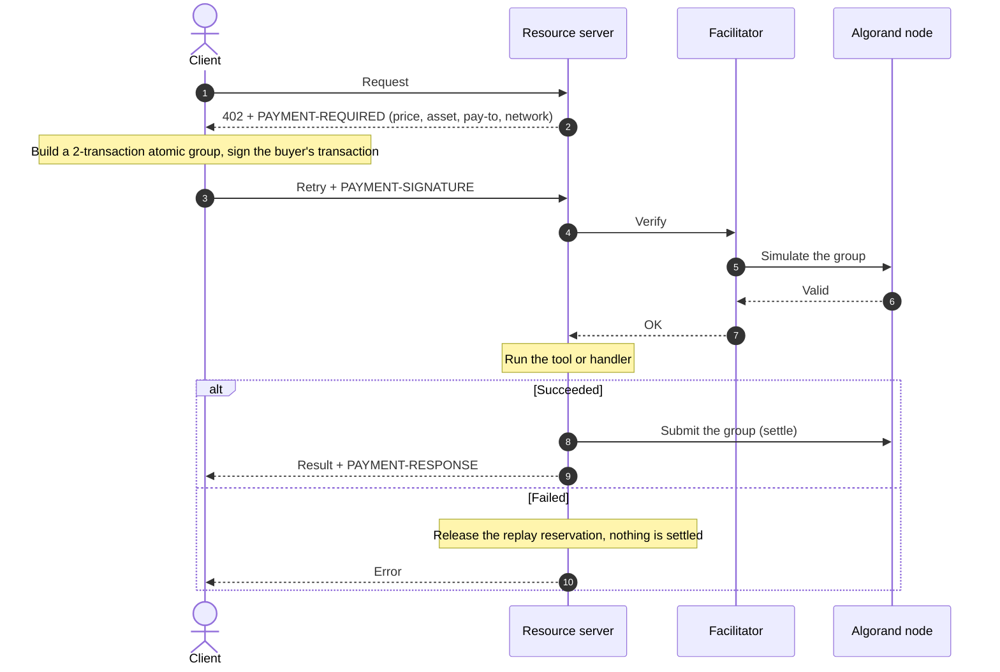

# x402-avm

SDKs for paying for APIs and AI tools per call on Algorand, using the x402 protocol (HTTP 402 Payment Required).

## What is this

x402 lets a server answer an unpaid request with `402 Payment Required` and a machine-readable price. The client pays and retries the same request. There are no accounts, API keys or subscriptions.

This organisation publishes the Algorand (AVM) side of that protocol: a payment scheme for the official x402 Python SDK, a Python SDK that turns an MCP server into a paid service and lets an MCP client pay for tools, and a browser and Node client that pays with any Algorand wallet. The SDKs are the product. The marketplace in this organisation is a demonstration built on them.

This repository is the hub: it describes the organisation, how the pieces fit, and where each one lives.

## Packages

| Package | Language | What it does | Install | Version | Repository |
|---|---|---|---|---|---|
| `ai-economy-sdk` | Python | Turns an MCP server into a paid service (`PaymentGate`, `AIEconomySDK`) and pays for tools as a client (`paid_mcp_session`, with spend controls). Identity proofs, passes, replay protection, settle only on success. | `pip install ai-economy-sdk` | [](https://pypi.org/project/ai-economy-sdk/) | [ai-economy-sdk](https://github.com/x402-avm/ai-economy-sdk) |
| `x402-algorand` | Python | The Algorand `exact` payment scheme as a plugin for the official x402 Python SDK (`x402` >= 2.28). Import name `x402_algorand`. | `pip install x402-algorand` | [](https://pypi.org/project/x402-algorand/) | [x402-algorand](https://github.com/x402-avm/x402-algorand) |
| `x402-avm-js` | TypeScript | Pays 402 responses from the browser or Node with any Algorand wallet. | `npm install x402-avm-js algosdk` | [](https://www.npmjs.com/package/x402-avm-js) | [x402-avm-js](https://github.com/x402-avm/x402-avm-js) |

## How it works



The payment is an atomic group of two transactions. The server is the fee payer (2,000 microALGO) and the buyer pays exactly the price. The group is submitted only if the tool succeeds. See [ARCHITECTURE.md](ARCHITECTURE.md) for the full lifecycle and trust model.

## Quickstart

The quickstarts run against a local AlgoKit LocalNet. Pass `"mainnet"` or `"testnet"` as the network to use a public network.

### Sell a paid MCP tool in Python

```python
import os
from algosdk import account, mnemonic
from algosdk.v2client import algod
from fastmcp import FastMCP
from ai_economy_sdk import DefaultAvmSigner, PaymentGate

# LocalNet algod; the server account must hold ALGO to pay network fees
ALGOD = algod.AlgodClient("a" * 64, "http://localhost:4001")
server_sk = mnemonic.to_private_key(os.environ["SERVER_MNEMONIC"])
server_addr = account.address_from_private_key(server_sk)

mcp = FastMCP("QuickstartServer")

@mcp.tool()
def echo(text: str) -> str:
    """Echo back input text."""
    return f"echo: {text}"

gate = PaymentGate(
    signer=DefaultAvmSigner(server_sk, algod_client=ALGOD),
    network="localnet",
    pay_to=server_addr,
    asset_id=0,                      # 0 = ALGO
    prices={"echo": 5000},           # microALGO per call
)

app = gate.wrap(mcp)                 # an ASGI app; serve it with uvicorn, e.g. uvicorn.run(app, port=9201)
```

The full example funds the account from the LocalNet dispenser instead of reading a mnemonic: [quickstart_server.py](https://github.com/x402-avm/examples/blob/main/localnet/quickstart_server.py).

### Pay from Python

```python
from ai_economy_sdk import paid_mcp_session

async with paid_mcp_session("http://127.0.0.1:9201/sse", buyer_sk, "localnet") as session:
    result = await session.call_tool("echo", {"text": "hello world"})
    print(result.content[0].text)    # echo: hello world
```

The buyer's balance falls by exactly the tool's price (5000 microALGO in this example). Full file: [quickstart_client.py](https://github.com/x402-avm/examples/blob/main/localnet/quickstart_client.py).

### Pay from the browser or Node

```ts
import { algodClient, decodePaymentRequired, payForRequirement } from 'x402-avm-js';

const algod = algodClient('mainnet'); // or 'testnet', 'localnet'
const res = await fetch(url);
if (res.status === 402) {
  const required = decodePaymentRequired(res.headers.get('PAYMENT-REQUIRED')!);
  const header = await payForRequirement(required, myAddress, algod, (txns, indexes) =>
    wallet.signTransactions(txns, indexes) // Pera, Defly, Lute, KMD, a local key
  );
  await fetch(url, { headers: { 'PAYMENT-SIGNATURE': header } });
}
```

Runnable LocalNet version: [js_pay.mjs](https://github.com/x402-avm/examples/blob/main/localnet/js_pay.mjs).

## Networks

Network ids follow the CAIP-2 Algorand profile: `algorand:` plus the first 32 characters of the URL-safe base64 genesis hash.

| Network | CAIP-2 id | USDC (ASA) |
|---|---|---|
| MainNet | `algorand:wGHE2Pwdvd7S12BL5FaOP20EGYesN73k` | 31566704 |
| TestNet | `algorand:SGO1GKSzyE7IEPItTxCByw9x8FmnrCDe` | 10458941 |
| LocalNet | derived from the node's genesis hash | none |

Prices are in base units (microALGO, or the ASA's smallest unit; USDC has 6 decimals).

## Repositories

| Repository | Contents |
|---|---|
| [ai-economy-sdk](https://github.com/x402-avm/ai-economy-sdk) | Python SDK for paid MCP servers and clients. |
| [x402-algorand](https://github.com/x402-avm/x402-algorand) | Algorand exact scheme plugin for the official x402 Python SDK. |
| [x402-avm-js](https://github.com/x402-avm/x402-avm-js) | Browser and Node client. |
| [examples](https://github.com/x402-avm/examples) | Runnable examples for LocalNet, TestNet and MainNet. |
| [marketplace-demo](https://github.com/x402-avm/marketplace-demo) | Demonstration marketplace: 64 paid AI tools from 4 vendors on LocalNet. |
| [x402-avm.github.io](https://github.com/x402-avm/x402-avm.github.io) | Source of the documentation site. |
| [x402-avm](https://github.com/x402-avm/x402-avm) | This hub. |

## Documentation

https://x402-avm.github.io. A machine-readable index is at [llms.txt](https://x402-avm.github.io/llms.txt).

Also in this repository: [ARCHITECTURE.md](ARCHITECTURE.md), [ROADMAP.md](ROADMAP.md), [AGENTS.md](AGENTS.md).

## Security

Report vulnerabilities privately, following the [organisation security policy](https://github.com/x402-avm/.github/blob/main/SECURITY.md). Do not open public issues for vulnerabilities. Never commit private keys or mnemonics.

## Licence

`ai-economy-sdk` and `x402-avm-js` are MIT. `x402-algorand` is Apache-2.0 and ships a `NOTICE` that reproduces the upstream notices. The content of this hub repository is MIT; see [LICENSE](LICENSE). Each repository carries its own licence file.

## Acknowledgements

- The [x402 Foundation](https://github.com/x402-foundation/x402) and the official x402 SDK, which `x402-algorand` plugs into.
- [GoPlausible/x402-avm](https://github.com/GoPlausible/x402-avm), from which `x402-algorand` is derived.
- The Algorand community and the [AlgoKit](https://github.com/algorandfoundation/algokit-cli) tooling used for LocalNet.
